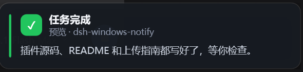

# dsh-desktop-alerts

[](https://dsh-plugin.org/plugins/depthinker925/dsh-desktop-alerts)

**DeepSeek Harness 的 Windows 桌面提醒插件。** 当 Agent 需要你回答问题、等待权限确认，或者一个回合跑完时，屏幕角落会弹出一张提醒卡片——不用一直盯着 DSH 窗口。点击卡片即可把 DSH 切回前台。

> A Windows desktop-alert plugin for DeepSeek Harness: a corner card when the agent asks a question, waits for a permission decision, or finishes a turn.



## 为什么

长时间任务里，DSH 经常在等你：

- Agent 用 `ask_user_question` 提问，或者在计划审批里等你点「批准」；
- 某个工具调用需要权限确认（文件写入、命令执行……）；
- 一个回合跑完了，结果就在那里，但你正在看别的窗口。

DSH 自己不会把窗口抢到前台，声音提示又很容易被忽略。这个插件把这三类事件变成一张**不抢焦点、不会被忽略、点一下就回去**的卡片。

## 安装

```bash
dsh plugin --profile web add dsh-desktop-alerts
```

也可以：

- **插件市场**：DSH 内打开「插件」，在插件中心搜索 `Windows 桌面提醒` 安装；
- **本地目录**：在「插件」页面选择「从本地目录安装」，指向本仓库根目录（开发时推荐，安装的是软链接，改完代码重启即生效）；
- **GitHub 直装**：`dsh plugin --profile web add github:depthinker925/dsh-desktop-alerts`。

安装后无需重启桌面端即可生效（插件管理会重新加载层）。

## 提醒的场景

| 事件 | 触发时机 | 卡片标题 |
| --- | --- | --- |
| `user-questions/request` | Agent 提问 / 计划审批 / 需要你确认 | DSH 需要你的输入 / 选择 / 确认 |
| `approval/request` | 工具调用需要权限决定 | DSH 请求权限 |
| `session/event` → `turn/end` | 回合正常结束 | 任务完成 |
| `session/event` → `turn/end`（`error`） | 回合因错误结束 | 任务出错 |

子代理（subagent）会话默认**不**提醒，避免一个多代理任务刷屏；需要的话把 `includeSubagents` 打开。

## 配置

配置写在 profile 的 `cordis.patch.yml`（或插件详情页的配置项）里，全部可选：

```yaml
- id: windows-notify
  name: dsh-desktop-alerts
  config:
    position: bottom-right   # bottom-right | top-right | bottom-left | top-left | center
    durationMs: 12000        # 卡片停留时长（毫秒，3000–120000）
    sound: true              # 是否播放系统提示音
    soundName: asterisk      # asterisk | beep | exclamation | hand | question | none
    clickAction: focus       # focus（切回 DSH）| url | none
    url: ""                  # clickAction = url 时打开的地址
    maxVisible: 3            # 同屏最多几张卡片
    minIntervalMs: 1200      # 两张卡片的最小间隔
    maxBodyChars: 220        # 正文截断长度
    language: auto           # auto | zh | en
    questions: true          # 提问提醒
    approvals: true          # 权限提醒
    completed: true          # 完成提醒
    errors: true             # 出错提醒
    includeSubagents: false  # 子代理会话也提醒
    showProject: true        # 卡片上显示项目目录名
    showToolName: true       # 权限卡片上显示工具名
    processName: DeepSeek Harness  # 点击卡片时聚焦的窗口进程名
    accents:                 # 各类型卡片的主色
      question: "#4D6BFE"
      approval: "#F5A524"
      completed: "#22C55E"
      error: "#EF4444"
```

## 它是怎么做的

- **纯 Host 插件**：`index.js` 只挂三个监听器（`user-questions/request`、`approval/request`、`session/event`），第一个是瀑布流监听器——提醒完立刻 `return next()`，绝不改变任何决策；
- **卡片由 WPF 渲染**：`lib/notify.ps1` 用 PowerShell 的 WPF（`AllowsTransparency` + `Topmost` + `ShowActivated=false`）画一张无边框卡片。**不抢键盘焦点**，不进通知中心，不需要注册 AUMID，也不受「专注助手」影响；
- **一次事件一个短进程**：Node 把卡片内容写成 UTF-8 JSON，`powershell.exe -File notify.ps1 -Payload <json>` 渲染并自动淡出，进程结束即回收；
- **堆叠**：多张卡片按 `stackIndex` 从角落往上排，最多 `maxVisible` 张；
- **为什么不用系统 Toast**：Windows 的 Toast 需要注册 AUMID / 打包身份，未注册的应用 `Show()` 会静默失败——实测在没有打包身份的 DSH 里不可靠。WPF 卡片是自己画的窗口，稳定可见。

## 兼容与限制

- 仅 Windows（`process.platform === 'win32'`），需要系统自带的 Windows PowerShell 5.1；
- 卡片显示在**主显示器**的工作区角落；多显示器 / 指定屏幕暂不支持；
- 卡片只在屏幕上前台展示，**不会**进入 Windows 通知中心，也不支持历史回看；
- 不改变 Agent 的任何行为：不拦截、不代答、不审批。

## 开发

```bash
# 直接预览一张卡片（不需要启动 DSH）
node scripts/preview.mjs
node scripts/preview.mjs --kind error --title "任务出错" --body "示例正文"

# 只打印将要传给渲染器的 payload
node scripts/preview.mjs --dry-run
```

装到 DSH 里调试：

```bash
dsh plugin --profile web add <本仓库绝对路径>
```

## 许可证

MIT
