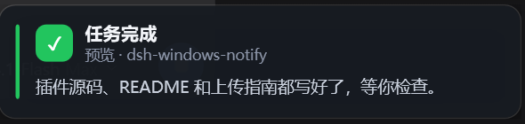

# Windows 桌面提醒

DSH 需要你的时候，弹一张卡片到屏幕角落。



## 解决什么问题

用 DSH 跑长任务时，人是离开窗口的。于是总出现这三种情况：

1. **Agent 在等你回答**——它提了一个问题，或者把计划递给你点「批准」，而你还在看别的窗口；
2. **工具在等你授权**——写文件、跑命令这类操作需要你确认权限，DSH 停在那里一动不动；
3. **任务其实早就跑完了**——结果躺在会话里，你以为还在跑。

插件把这三类事件变成一张屏幕角落的提醒卡片：看得见、不抢焦点、点一下就回到 DSH。

## 卡片长什么样

- 无边框圆角卡片，深色底、左侧一条主色竖条，按事件类型换色（提问=蓝、权限=琥珀、完成=绿、出错=红）；
- 顶部是图标 + 标题 + 一行元信息（类型 · 项目目录 · 回合号）；
- 下面是正文：提问时是问题本身（带选项预览），权限时是权限理由，完成时是最后一条回复的收尾；
- 停留 12 秒后自动淡出；鼠标移上去点一下，DSH 窗口回到前台；
- 多张卡片从右下角往上堆叠，互不遮挡。

卡片是 WPF 画的独立置顶窗口，**不抢键盘焦点**（`ShowActivated=false`），所以你正在打字也不会被打断。

## 提醒哪些事件

| 事件 | 说明 | 默认 |
| --- | --- | --- |
| `user-questions/request` | Agent 提问、计划审批、需要确认 | 开 |
| `approval/request` | 工具调用需要权限决定 | 开 |
| `turn/end`（completed） | 回合正常结束 | 开 |
| `turn/end`（error） | 回合因错误结束 | 开 |
| 子代理会话 | 多代理任务里的子会话 | 关 |

插件对这几个事件是**只读旁观**：提问 / 权限是瀑布流监听器，提醒完立即 `return next()`，不会替你回答，也不会改变审批结果。

## 配置

在 profile 的 `cordis.patch.yml` 里改 `windows-notify` 这一行即可，常用项：

```yaml
- id: windows-notify
  name: dsh-desktop-alerts
  config:
    position: bottom-right
    durationMs: 12000
    sound: true
    clickAction: focus
```

完整配置项见仓库 README。

## 兼容性

- 仅 Windows，依赖系统自带的 Windows PowerShell 5.1；
- 卡片显示在主显示器工作区；多显示器暂不支持；
- 不进 Windows 通知中心，不保留历史；
- 如果你想用系统原生 Toast：Windows 要求应用有注册的 AUMID（通常意味着打包成 MSIX），未注册的应用调用 Toast 会静默失败，所以本插件用自绘窗口而不是 Toast。

## 开发与反馈

```bash
node scripts/preview.mjs          # 不改代码，直接看一张卡片
dsh plugin --profile web add .    # 本地目录安装（软链接，改完重启生效）
```

问题、建议、PR 都欢迎。
